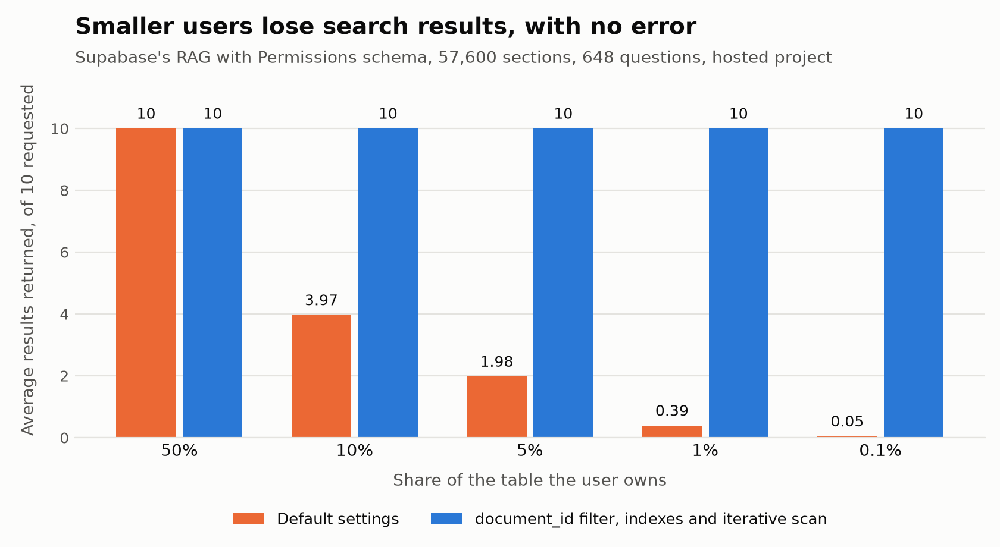

# filtered-retrieval-bench

**With Row Level Security on a pgvector HNSW index, users who own a small share of a table silently lose search results.** On a hosted Supabase project using the schema and policy from Supabase's [RAG with Permissions guide](https://supabase.com/docs/guides/ai/rag-with-permissions), a user owning 1% of 57,600 sections got no results for 65.9% of questions, and no error.

Filtering on `document_id` in the search query, with two btree indexes and iterative scan, gave every user size all 10 results. The guide's RLS policy stays unchanged.



This is an independent benchmark, not a Supabase project.

## Results

Measured on a free Supabase project (pgvector 0.8.2) with 648 questions and 10 results requested per question. Correct results come from an exact scan under the same policy.

| User owns | Default: results | Default: no results | Default: recall@10 | Fixed: results | Fixed: recall@10 | Fixed: median latency |
|---|---|---|---|---|---|---|
| 50% | 10.00 | 0% | 0.962 | 10.00 | 0.962 | 7.8 ms |
| 10% | 3.97 | 1.5% | 0.396 | 10.00 | 0.971 | 7.1 ms |
| 5% | 1.98 | 13.0% | 0.198 | 10.00 | 0.979 | 11.0 ms |
| 1% | 0.39 | 65.9% | 0.039 | 10.00 | 1.000 | 1.5 ms |
| 0.1% | 0.05 | 95.7% | 0.005 | 10.00 | 1.000 | 0.7 ms |

- **Multiple owners:** the guide's multiple-owner version, with a `document_owners` table, gave the same counts and recall before and after the fix.
- **The guide's own query:** it has a similarity threshold and no `LIMIT`, and it still uses the HNSW index. The 1% user got 0.48 results and no results for 69.6% of questions, with recall 0.304 against an exact scan using the same threshold.
- **No leaks:** no user received another user's rows in any run.

Full results are in [guide_schema_supabase.json](results/guide_schema_supabase.json).

## Why it happens

The index finds its nearest 40 rows first (`hnsw.ef_search`), and RLS removes the ones the user doesn't own afterwards. If you own 1% of the table, few of those 40 survive. [pgvector's README](https://github.com/pgvector/pgvector#filtering) documents this for filters in general.

In the guide's schema, sections have no owner column. The policy checks each section's `document_id` against the user's documents, so the planner can't use the policy to find a user's sections directly.

| Fix, tested on the 0.1% user | Results | Recall@10 |
|---|---|---|
| Iterative scan alone | 8.94 | 0.680 |
| Iterative scan with `max_scan_tuples` and `scan_mem_multiplier` raised | 10.00 | 0.999, median 105 ms, p95 1.1 s |
| Owner copied onto sections, with an index, a query filter and iterative scan | 8.94 | 0.680 |
| `document_id` filter and indexes, without iterative scan | 10.00 | 1.000, but the 10% and 5% users still got 3.97 and 1.98 |
| **`document_id` filter, indexes and iterative scan** | **10.00** | **1.000, median 0.7 ms** |

The `document_id` filter likely works because `auth.uid()` in the query itself, unlike `(select auth.uid())` in the policy, lets the planner estimate how many documents the user owns. For small users it then goes through the indexes, and for large users it stays on HNSW, where iterative scan fills the results. I haven't established why copying the owner onto sections fails here, when the same filter worked on a single table.

**Results come back out of order without a re-sort.** With `relaxed_order`, results for 18% to 20% of questions for the 10%, 5% and 1% users weren't in distance order. pgvector's re-sort with a materialized CTE brought this to 0%.

## The fix

```sql
CREATE INDEX ON public.document_sections (document_id);
CREATE INDEX ON public.documents (owner_id);
-- Multiple owners: CREATE INDEX ON public.document_owners (owner_id, document_id);

-- Keep the guide's RLS policy unchanged as the safety net.

CREATE FUNCTION public.match_document_sections(query_embedding vector(384), match_count int)
RETURNS TABLE (id bigint, distance float8) LANGUAGE plpgsql STABLE
SET hnsw.iterative_scan = relaxed_order
AS $$
BEGIN
  RETURN QUERY
  WITH nearest AS MATERIALIZED (
    SELECT s.id, s.embedding <=> query_embedding AS distance
    FROM public.document_sections s
    WHERE s.document_id IN (SELECT d.id FROM public.documents d WHERE d.owner_id = auth.uid())
    -- Multiple owners: SELECT o.document_id FROM public.document_owners o WHERE o.owner_id = auth.uid()
    ORDER BY distance
    LIMIT match_count
  )
  SELECT nearest.id, nearest.distance FROM nearest ORDER BY nearest.distance + 0;
END $$;
```

`+ 0` is needed on Postgres 17 and later, as pgvector's README notes. Don't remove the `auth.uid()` filter or take the user ID from the request. Keep the function `SECURITY INVOKER`, which is the default.

[verify_guide_recipe.py](scripts/verify_guide_recipe.py) tests this function as `LANGUAGE sql`, PL/pgSQL, and PL/pgSQL with a dynamic query, for both versions of the schema, on 100 questions. All three returned 10 results in distance order for every user, with recall from 0.954 to 1.000 and no leaks.

## Checking the function on the hosted project

[check_search_function.py](scripts/check_search_function.py) runs the recipe above as `public.match_guide_sections` on the guide's schema and checks it the way you would before shipping. Results are in [function_checks_supabase.json](results/function_checks_supabase.json).

- **It can't bypass RLS:** the function is `SECURITY INVOKER`. Its filter uses `auth.uid()` where the policy uses `(select auth.uid())`, so the planner can estimate the user's share, and for every test user it selects exactly the rows the policy allows. No search returned another user's row.
- **Plans differ by user size, as intended:**

  | User's share | Plan (20 of 20 searches) | Results | Recall@10 |
  |---|---|---|---|
  | 50%, 10% | HNSW, iterative scan | 10.00 | 0.962, 0.971 |
  | 5%, 1%, 0.1% | `document_id` btree | 10.00 | 1.000 |
  | 1.5% to 4%, near the switch point | `document_id` btree | 10.00 | 1.000 |
  | 0.5%, 3%, 10%, documents least similar to the questions | btree, btree, HNSW | 10.00 | 1.000, 1.000, 0.965 |

  On this project the planner switches between 5% and 10%. Locally it switched between 10% and 50%, so don't hard-code a threshold.
- **A pooled connection doesn't carry one user's plan to the next:** after 20 searches by the 50% user, 100 searches by the 0.1% user on the same connection were all full and correct, and a prepared statement switched from HNSW to btree when the user changed.
- **Shortfall alert:** the function logs a line when it returns fewer rows than requested to a user who owns at least that many sections. It never fired on the fixed function. On the original function, 100 of 100 short searches raised it.

  ```sql
  -- inside the plpgsql function, after RETURN QUERY ...
  GET DIAGNOSTICS returned = ROW_COUNT;
  IF returned < match_count THEN
    SELECT count(*) INTO owned FROM (
      SELECT 1 FROM public.document_sections s
      WHERE s.document_id IN (SELECT d.id FROM public.documents d WHERE d.owner_id = auth.uid())
      LIMIT match_count) o;
    IF owned >= match_count THEN
      RAISE LOG 'search_shortfall user=% returned=% requested=% owned_at_least=%',
        auth.uid(), returned, match_count, owned;
    END IF;
  END IF;
  ```

  To find these in the dashboard, run this in Logs Explorer. I checked that the alert fires, not that the line appears there:

  ```sql
  select timestamp, event_message from postgres_logs
  where event_message like '%search_shortfall%'
  order by timestamp desc limit 100;
  ```

- **Latency on free Nano compute:** for the large users, a repeated search takes 2.7 to 2.9 ms (median, `EXPLAIN (ANALYZE, TIMING OFF)`, matched by `pg_stat_statements`). The first search with a new query vector takes 0.2 to 0.5 s however it is timed, likely because index pages have to come back into memory on this 0.5 GB instance. Through PostgREST from Pakistan, a call takes about 0.3 s for a repeat and 0.5 s for a first run, mostly network. `EXPLAIN ANALYZE` with per-node timing added up to a second on this instance, so it isn't used for timings.

## Also measured on a single table

The first round used one table with an `owner` column and the policy `owner = (select auth.uid())`. Default results were nearly the same: 0.44 for the 1% user and 0.04 for the 0.1% user. An owner index, a query filter and iterative scan fixed every user size, but written as a `LANGUAGE sql` function the same query returned only 8.92 results at 0.664 recall for the 0.1% user. I haven't established why. Results are in [fixes_supabase.json](results/fixes_supabase.json) and [recipes_supabase.json](results/recipes_supabase.json).

## Does it improve search quality?

These scores use FiQA's human relevance labels on local Postgres and the single table, with three ownership seeds, for users owning 50%, 10%, 5% and 1%. Settings were chosen on dev questions and reported on test questions. Each user is only asked questions they own relevant documents for, which can flatter the scores, so use them to compare methods, not to predict production quality. Here, "fixed" sends users owning up to 6,000 rows through the owner index and larger users through HNSW with iterative scan.

| Method | nDCG@10 (95% CI) | Recall@10 |
|---|---|---|
| Vector, no fix | 0.536 (0.520–0.553) | 0.562 |
| **Vector, fixed** | **0.601 (0.585–0.617)** | **0.669** |
| Vector, exact scan | 0.603 (0.587–0.618) | 0.672 |
| Keyword only | 0.151 (0.139–0.162) | 0.216 |
| Hybrid (RRF) | 0.601 (0.585–0.616) | 0.669 |

The intervals treat each scored question as independent, though questions repeat across seeds, so they are somewhat too narrow.

- **The fix helps:** nDCG@10 rises by 0.064 (95% CI 0.057 to 0.072), and it nearly matches an exact scan.
- **Hybrid search didn't help on this dataset:** the difference from vector search was 0.000 (CI −0.001 to +0.001), including on the 93 scored questions with rare terms.
- **The reason shows up in the tuning:** on dev questions, keyword search with AND returned nothing for 71.8% of questions. With OR it found matches, but pulled hybrid nDCG down to 0.382. The tuned hybrid chose a score floor that silenced keyword search for 98% of questions, so it behaves like vector search.

That last result covers Postgres full-text search on natural-language finance questions, not hybrid search in general.

## Limits

- FiQA texts stand in for sections. They are grouped at random into documents of 8 sections, so a document's sections don't share a topic, and ownership is assigned at random with one seed.
- In the multiple-owner version each document has one owner, so this tests the policy's shape, not real sharing.
- 57,600 sections is small. Iterative scan stops at about 20,000 rows by default, so very small users in much larger tables may behave differently.
- Relevance scores ran on local Postgres and the single table, not on the guide's schema or hosted Supabase.
- Latency on free Nano compute is noisy, so compare large differences only. Local and hosted timings aren't comparable, and concurrent load wasn't tested.
- The embedding model truncates long texts.
- I found public reports of filtered vector search returning too few rows ([example](https://github.com/pgvector/pgvector/issues/684)), but none that names RLS. This is a measurement, not a reported production incident.

## Run it

Everything except the Supabase backend runs locally, with no API keys or Docker. Embedding takes about 90 minutes on a 4-core CPU.

```bash
python -m venv .venv
.venv/Scripts/pip install -r requirements.txt
curl -L -o fiqa.zip https://public.ukp.informatik.tu-darmstadt.de/thakur/BEIR/datasets/fiqa.zip
python -m zipfile -e fiqa.zip data/
.venv/Scripts/python src/embed.py
.venv/Scripts/python src/evaluate_fixes.py --backend local
.venv/Scripts/python src/evaluate_guide_schema.py --backend local
.venv/Scripts/python scripts/verify_guide_recipe.py --backend local
.venv/Scripts/python src/evaluate_relevance.py --backend local --seeds 42 43 44
.venv/Scripts/python src/gate.py results/relevance_local.json results/fixes_supabase.json
```

`evaluate_guide_schema.py` copies embeddings from the single table that `evaluate_fixes.py` builds, so run that first.

To check the search function, run `.venv/Scripts/python scripts/check_search_function.py --backend supabase` after `evaluate_guide_schema.py`. It takes about 3 hours on the hosted project; `--timing-only` re-times the large users in about 15 minutes.

To use Supabase, copy `.env.example` to `.env`, add your Session pooler connection string, and pass `--backend supabase`. The RPC timing also needs `SUPABASE_URL`, `SUPABASE_ANON_KEY` and the legacy `SUPABASE_JWT_SECRET`; it is skipped without them. Use a project without real data, because these scripts create and replace tables and policies. Both tables together need about 430 MB, close to the free plan's 500 MB.

### Checks

```bash
.venv/Scripts/python -m pytest
.venv/Scripts/python scripts/mutation_check.py
```

- **Tests** run the real SQL and RLS on a small database whose rankings can be worked out by hand.
- **`mutation_check.py`** breaks the code in 15 ways, such as disabling RLS, and confirms the tests fail each time.
- **`gate.py`** fails if a score drops below [baseline.json](baseline.json), a row leaks, or the setup has changed.

More detail is in [DATA_AND_EVALUATION.md](docs/DATA_AND_EVALUATION.md).

## Data licence

The code is MIT licensed. The FiQA data isn't included: its challenge site says non-commercial use, while the BEIR card says cc-by-sa-4.0, so check its terms before use.
